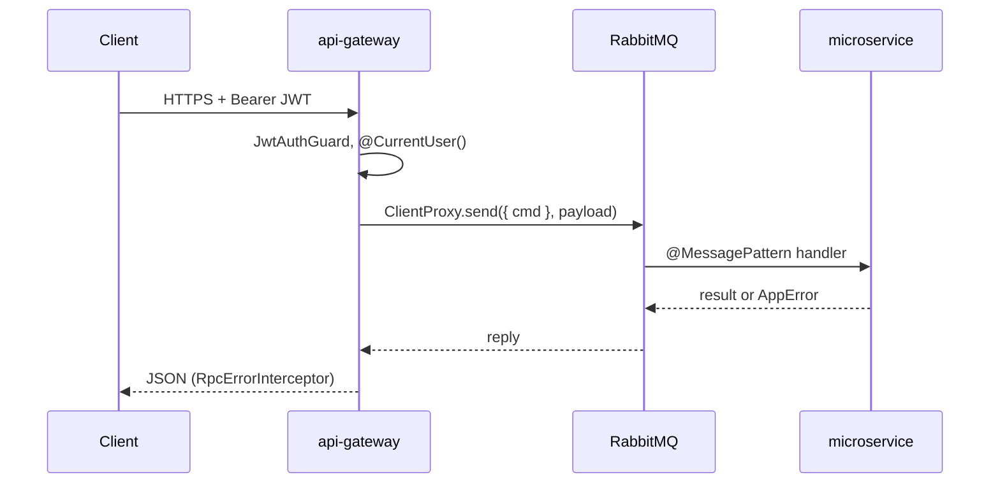

# BookBuddy — architecture (overview)

## Request flow



## Services

| Service     | Queue             | MongoDB (local Docker port) |
| ----------- | ----------------- | --------------------------- |
| api-gateway | HTTP + RMQ client | —                           |
| auth        | `auth_queue`      | —                           |
| user        | `user_queue`      | `27017`                     |
| club        | `club_queue`      | `27018`                     |
| library     | `library_queue`   | `27019`                     |
| book        | `book_queue`      | `27020`                     |
| chat        | `chat_queue`      | `27021`                     |

## Infrastructure (`docker compose`)

- RabbitMQ: `5672` (AMQP), management UI `15672`
- Redis: `6379`

## Communication rules

- External clients → **api-gateway** (REST, Swagger `/api`, JWT).
- Gateway підставляє **identity з JWT** (`userId`, `actorId`) у RMQ payload; body не є джерелом правди для «хто я».
- Gateway → microservices via **RabbitMQ** request/reply (`AuthCmd`, `UserCmd`, … from `@bookbuddy/shared`).
- Gateway is **HTTP only** (no RMQ consumer). Queues: `RmqQueue` constants, **durable** queues.
- Cross-service checks: e.g. **chat** → **club** RPC (членство в клубі), **library** → **book** RPC (каталог).

## Repo layout

Детальніше: [repo-structure.md](./repo-structure.md).

```
server/
  api-gateway/     # HTTP edge
  auth/ user/ book/ library/ club/ chat/
  packages/shared/ # @bookbuddy/shared
  packages/nest-common/
  docs/
  docker/
  tooling/
```
